<h1 align="center">Goyal TV Home</h1>

<p align="center">
  <em>A calm, fast home screen for an Android TV: a clock-and-calendar left half like iPhone StandBy, the weather outside in the
  background, the day's festival, an AirPlay switch, and a black always-on standby.</em>
</p>

<p align="center">
  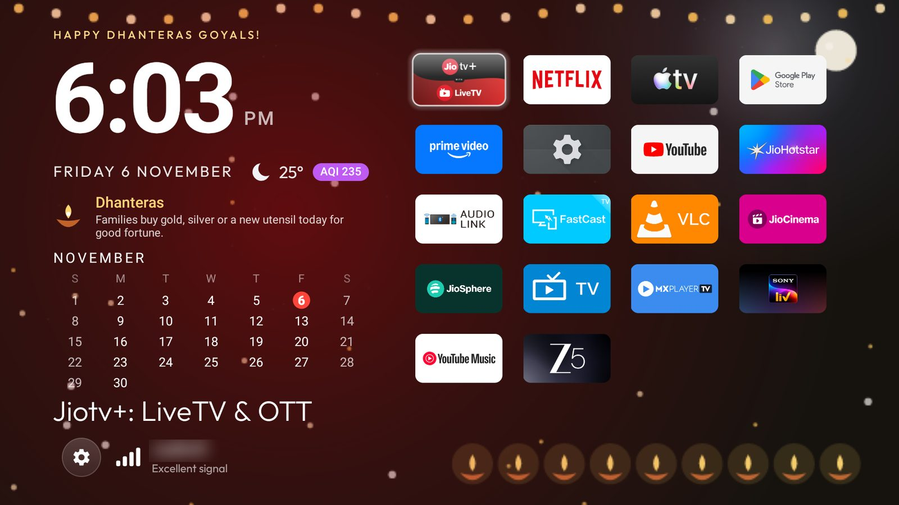
</p>

A small Android TV launcher (about 620 KB, plain Java, no analytics, no accounts) made for one 2 GB Android TV 9 set. It is
tuned for a weak GPU: nothing animates in the main window except a quick spring on focus, and everything that moves for its own
sake is drawn behind the window or not at all.

> It builds on the open-source [CleanYourTV](https://github.com/Gathin23/cleanyourtv) launcher by Gathin (MIT), and keeps its code and
> licence. The Java package is still `com.gathin.tvhome` so that an installed copy upgrades in place.

## A tour

### Split home
A static left half (greeting, big Roboto clock, date, weather and air quality, the month calendar, the focused app's name, and the
controls with the Wi-Fi name and signal) and the apps on the right, sorted by how often you open them. Roomy gaps and a gentle
zoom keep a focused tile clear of its neighbours; an app grows out of the tile you pressed.

<p align="center">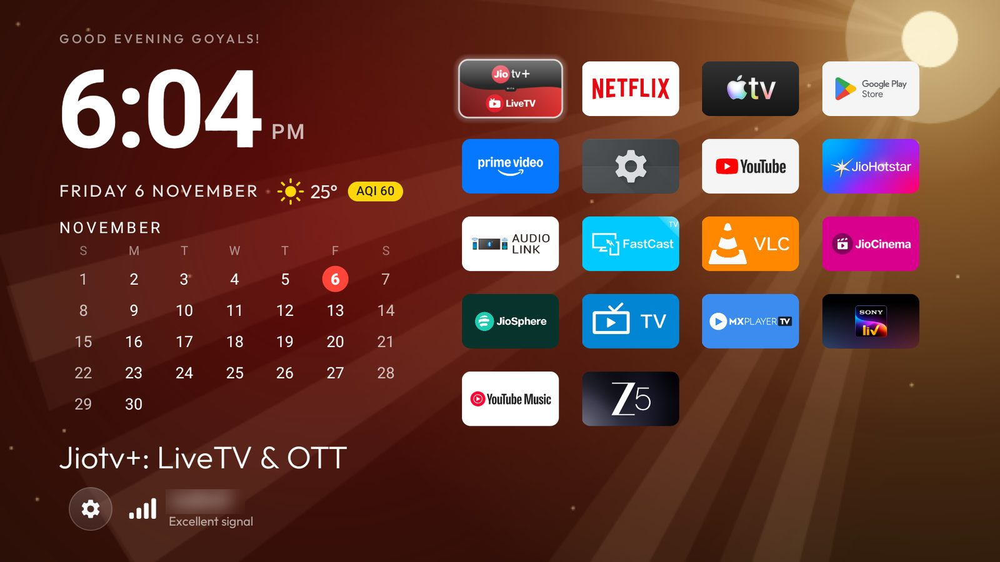</p>

### Control Centre
The round gear opens a glass panel: Wi-Fi, Bluetooth (it only ever switches Bluetooth *on*, so a stray press cannot cut off a
Bluetooth remote), Inputs, Settings, **AirPlay** and the launcher's own settings. Menus open upwards when their button is near the
bottom of the screen, so the HDMI list is never cut off.

| | |
|---|---|
| 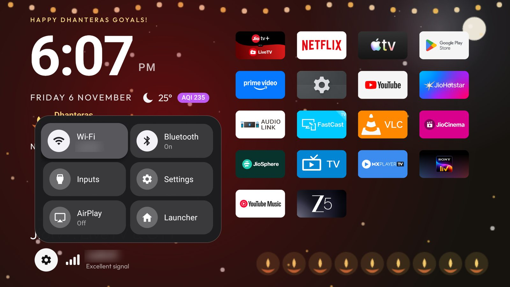 | 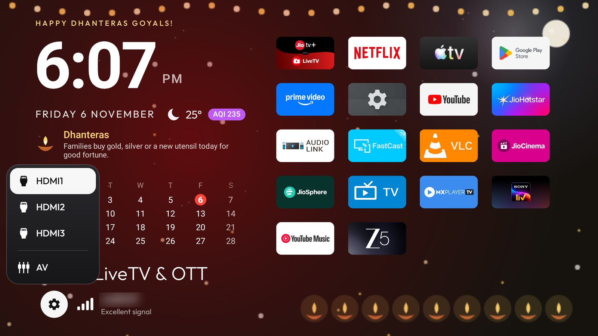 |

### Volume pill
A liquid-glass level pill replaces the vendor's volume bar and draws over any app (it needs "Display over other apps").

<p align="center">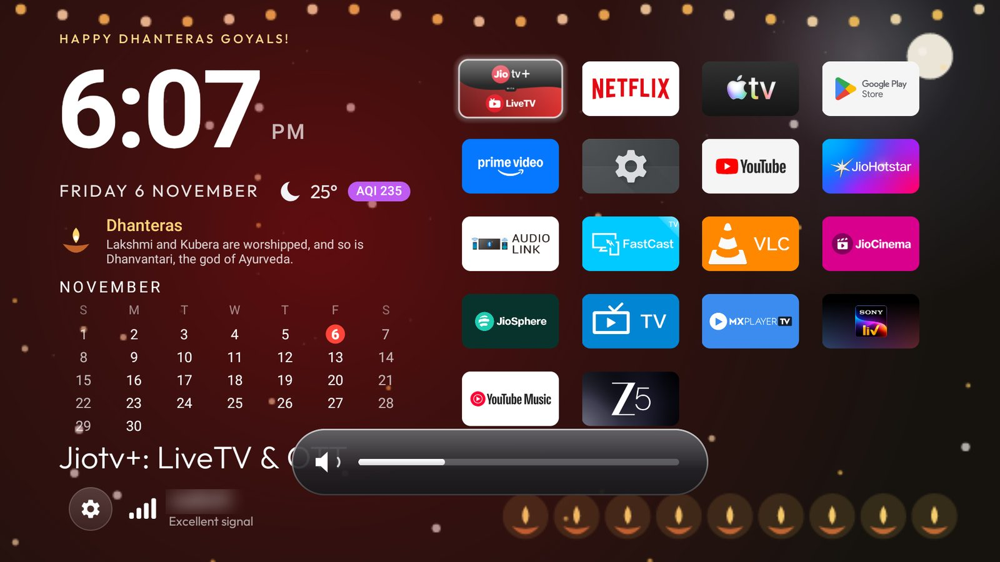</p>

### The weather outside
[Open-Meteo](https://open-meteo.com) gives the temperature, wind, cloud cover, rain and US AQI for your city. A small scene is drawn into
its own surface *behind* the window, at a frame rate that suits each scene, and it pauses while you move the cursor so the tiles never
repaint for it. Smog haze builds as the AQI rises.

| | | |
|---|---|---|
|  |  | 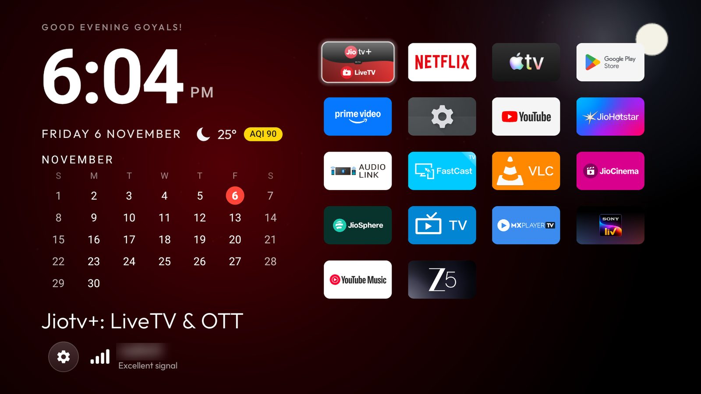 |
| Sun, rays and dust | Rain | Moon and stars |
|  | 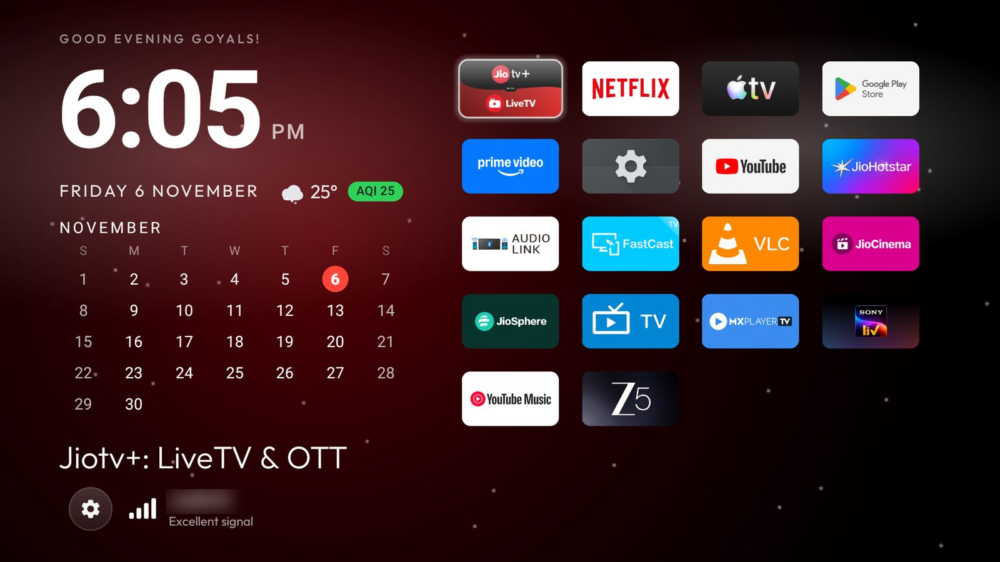 | |
| Storm | Snow | Cloud and fog too |

### Festivals
Hindu festivals and Christmas are on the calendar (`launcher/app/src/main/res/raw/festivals.csv`, built by
`tools/festival_calendar.py` from open data). On the day: a greeting such as "Happy Dhanteras Goyals!", a card with the festival and a
rotating tidbit, a countdown in the week before, and still decorations (a marigold garland, a row of diyas, fixed sparkles).

| | | | |
|---|---|---|---|
| 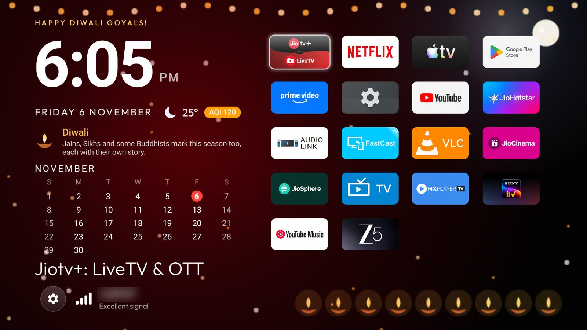 |  | 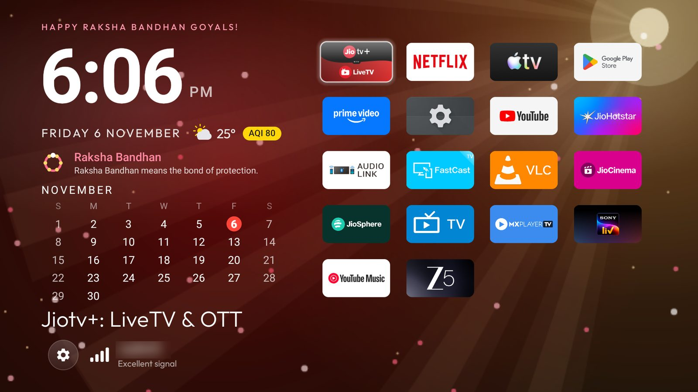 | 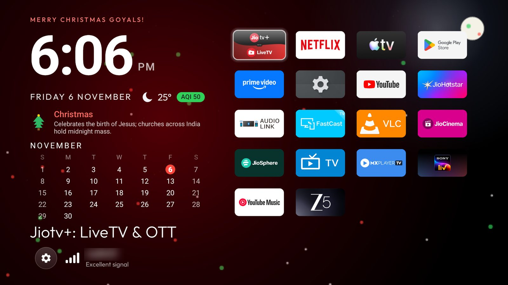 |
| Diwali | Holi | Raksha Bandhan | Christmas |

### Standby
After 15 idle minutes the TV shows `AodDream`, in the manner of an always-on display: pitch black, the left half only, plain white,
today in an outlined circle, nudged a few pixels a minute. Any button wakes it.

<p align="center">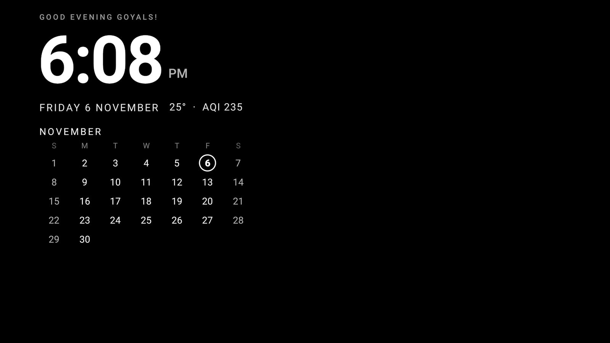</p>

### AirPlay on demand
The TV's own receiver (the FastCast system app) advertises as an Apple TV and runs all the time, using 60 to 110 MB. The AirPlay
tile starts it only when you want it and stops it again after 25 idle minutes (it checks that nothing is being cast first).

## Install

You need JDK 17 and the Android SDK (platform 34, build-tools 34.0.0), and network debugging on the TV.

```bash
echo "sdk.dir=$ANDROID_HOME" > launcher/local.properties
cd launcher && ./gradlew assembleRelease
adb connect <tv ip>:5555
adb install -r app/build/outputs/apk/release/app-release.apk
adb shell appops set com.gathin.tvhome SYSTEM_ALERT_WINDOW allow                    # the volume pill
adb shell pm grant com.gathin.tvhome android.permission.ACCESS_FINE_LOCATION         # Android 9 shows the Wi-Fi name only with it
adb shell cmd package set-home-activity com.gathin.tvhome/.MainActivity               # make it Home
adb shell settings put secure screensaver_components com.gathin.tvhome/.AodDream      # standby
adb shell settings put secure screensaver_default_component com.gathin.tvhome/.AodDream
```

The first time you press the AirPlay tile the TV asks "Allow USB debugging?" for the launcher's own key: tick *Always allow*.

### Settings
Edit `launcher/app/src/main/res/values/config.xml` before building:

| Key | What it does |
|---|---|
| `greeting_name` | The name after the greeting ("Good Evening Goyals!") |
| `weather_city` | A city for the weather, AQI and background; empty turns them off |
| `weather_fahrenheit` | Temperature in Fahrenheit |
| `split_layout` | The split home screen (`false` gives the single-column home) |
| `sort_by_usage` | Most-used apps first |

### Preview without waiting
Put one of these in `/sdcard/Android/data/com.gathin.tvhome/files/` and press Home; delete the file to go back to live data.

- `weather_override.json`: `{"code":63,"aqi":180}`. Any WMO weather code, plus `day`, `wind`, `cloud`, `precip`, `aqi`.
- `festival_date.txt`: an ISO date such as `2027-03-22` (Holi).

## How it works

- **The GPU is the bottleneck.** On this set the GPU takes about 26 ms just to blend the screen at 1080p, so anything animated *in* the
  window repaints everything. The weather scene is software-drawn off the UI thread into a small surface behind the window instead, and
  the festival decorations are still.
- **AirPlay.** Stopping another app needs the shell's rights, so `LocalAdb.java` talks to the TV's own `adbd` on localhost with a key you
  approve once, and only ever sends the fixed commands in `AirPlayControl.java`. Revoking USB-debugging authorisations in Developer
  options removes that access (and your computer's, too). If network debugging is off, the tile cannot stop the receiver.
- **Festival dates** come from [python-holidays](https://github.com/vacanza/python-holidays) and, for Raksha Bandhan, Ganesh Chaturthi
  and Navratri, from the real positions of the Sun and Moon ([astronomy-engine](https://github.com/cosinekitty/astronomy)) with the usual
  panchang rules. `pip install holidays astronomy-engine && python3 tools/festival_calendar.py 2026 2036` rebuilds the table;
  `--check` compares the rules with python-holidays.
- **Permissions beyond a plain launcher:** `INTERNET` (weather), `CHANGE_WIFI_STATE` and `BLUETOOTH*` (the switches),
  `SYSTEM_ALERT_WINDOW` (volume pill), `ACCESS_FINE_LOCATION` (Wi-Fi name on Android 9).

## Limits

Tuned and tested on one set (a SANYO Android TV 9, Realtek RTD285O, 2 GB). The Gemini voice assistant is not supported on Android 9, and
flashing different firmware is out of scope. The Hindu festival dates are computed, not authoritative: Janmashtami in particular has a
Vaishnava and a Smarta date that can differ by a day.

## Credits and licence

MIT, see [LICENSE](LICENSE). The launcher is built on [CleanYourTV](https://github.com/Gathin23/cleanyourtv) by Gathin (MIT); the Outfit
font and Fluent emoji keep their own licences in `launcher/`. Weather and air quality by [Open-Meteo](https://open-meteo.com).
